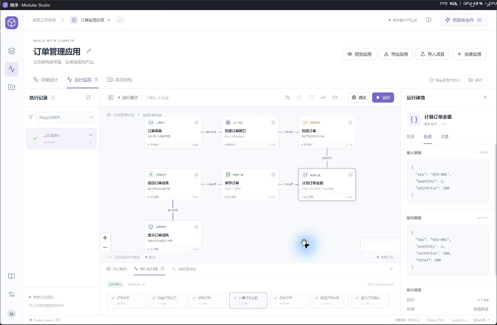

# 模序 · Modular Studio

本地可运行的软件开发工作台，版本 **0.2.1 预览版**。用功能模块和逻辑积木设计应用，生成真实代码，观察执行数据，连接自己的模型 API 提出修改建议。

## Windows 桌面应用

已支持独立桌面窗口：双击打开，自动启动本地服务，不需要打开终端。

- [下载安装包](https://github.com/Ackfy070330/modular-studio/releases) · Windows 10/11 x64
- [桌面版开发、打包和数据说明](docs/DESKTOP.md)
- 本版为未签名的个人预览版本。应用内可检查更新、下载并校验安装包，由用户手动安装。

从源码打开桌面版：

```powershell
npm ci
npm run desktop
```



## 网页开发模式

需要 **Node.js 24+** 和 npm。在项目根目录执行：

```powershell
npm install
npm run dev
```

打开 **http://127.0.0.1:5173/**。后端同时监听 `127.0.0.1:4310`。前端支持热更新；修改后端代码后重新启动，或分别使用 `npm run dev:api` 和 `npm run dev:web` 开发。

构建后可由一个服务提供前后端：

```powershell
npm run build
npm start
```

此时打开 **http://127.0.0.1:4310/**。请先停止其他占用 4310 端口的工作台进程。按 `Ctrl+C` 停止服务。首次运行自动创建订单示例；之后从本地数据库恢复项目。

## 现在可以做什么

| 功能 | 0.2 实现 |
| --- | --- |
| 可视化设计 | 拖放、连接、复制、删除模块，编辑属性，撤销/重做，保存版本，导入/导出蓝图 |
| 自动整理 | 预览连接方案，补充入口和输出，按可推断的字段依赖串联模块；确认后应用，可撤销 |
| 有界循环 | 固定轮数、数字字段退出条件、独立或完整嵌套循环；逐轮数据、断点、2000 步总上限 |
| 应用更新 | 从本仓库检查新版本，显示下载进度，支持取消与重试，通过大小与 SHA-256 校验后显示安装包 |
| 自定义内容 | 自定义模块和连线名称、需求说明，API 生成字段赋值或映射；保存草稿，审阅后生效 |
| Scratch 风格逻辑 | Blockly 字段、常量、四则运算和输出积木，生成安全的表达式 AST |
| 真实执行 | 蓝图生成 Node.js 程序，独立进程运行；表单、校验、计算、SQLite 存储、响应和展示串联 |
| 数据流追踪 | 节点输入/输出、错误、耗时、本地环境、历史蓝图版本和对应源码；敏感字段按名称遮盖 |
| 调试 | Node Inspector 真实断点、单步、继续、停止；暂停时显示变量与调用栈 |
| 导入项目 | 只读扫描 JS/TS 源文件、函数/组件、相对导入关系和候选路由；可查看源码 |
| 智能体协作 | 通用 Chat Completions 兼容 API，模型提出已有蓝图模块的修改建议，用户审阅并应用 |
| 交付应用 | 页面预览真实调用后端；导出独立应用 ZIP，包含页面、服务端代码、蓝图和启动说明 |

## 五分钟体验

1. 打开默认“订单管理应用”，点击**运行**，保持数量 `2`、单价 `100`，得到 `total: 200` 和真实写入的记录 ID。
2. 选中“计算订单金额”，打开模块属性，点击**编辑积木逻辑**。把乘法改成加法，应用并保存，再运行会得到 `102`。可恢复乘法继续体验。
3. 在模块属性启用**模块断点**，点击**调试**。暂停后查看变量和调用栈，使用“执行下一行”或“继续执行”。调试耗时包含断点暂停时间，不用于性能比较。
4. 点击**预览应用**提交生成的表单；点击**导出应用**获得可以独立启动的源码。
5. 点击**导入项目**，填入本地项目绝对路径。可以先导入本仓库的 `examples/order-app`，观察 `app.mjs → pipeline.mjs` 的实际文件依赖。

窗口较窄时，模块库和属性面板默认收起，可用画布工具栏两侧的按钮打开。

## 添加模块与自定义内容

- 点击画布工具栏的**添加模块**，选择内置类型或**自定义模块**；也可以打开模块库点击或拖入。内置模块新增后需从端口连接到流程。
- 自定义模块可填写名称和自然语言需求，例如“把 total 乘以 0.9 写入 discountedTotal”。新建时优先插入选中的处理步骤之后；没有可用连接时需手动连接。
- **点击已有连线**，可自定义连线名称、传递说明与字段映射，例如“把 discountedTotal 复制为 orderAmount”。映射在下游节点之前执行，运行记录中的下游输入会体现映射结果。
- 创建或修改自定义内容必须先配置 API 地址、模型及 **API Key**。未配置时显示接入引导，后端也会拒绝相应修改。查看已有内容及运行已生成的本地逻辑无需再次调用模型。
- 点击**使用 API 生成逻辑**，审阅字段赋值预览，再**保存到蓝图**。也可以**保存草稿**，但草稿或修改后未重新生成的内容不能运行。AI 字段赋值支持复制、常量、四则运算及原样传递，不执行任意代码。循环控制单独在连线设置中配置，无需 API Key。

## 第二版：自由摆放、整理与循环

1. 在“新建应用”中选择**循环示例**，默认输入运行后得到 `total: 300`。累加节点执行三次，数据存储在循环外，只写入一次。
2. 在运行时间线选择某一次执行，或使用右侧“查看某次执行”下拉框，检查该次输入与输出。断点会在每次进入模块时命中。
3. 点击返回自身或前面处理步骤的连线，开启**循环返回线**；保留原来的前进连线作为出口。可选择固定轮数，或“条件为真时继续”。总轮数包含第一次，范围为 1–100；条件在每轮结束后检查。
4. 模块摆放位置不决定执行顺序。没有连接好时点击**自动整理**，审阅补充模块、连接、回路和执行顺序，再应用。自动识别的回路暂设为三轮，应用前须审阅，应用后可修改。
5. 缺失字段、多个入口、无法保留自定义映射等情况会给出说明，原图保持不变。自动整理不是任意业务需求的自动实现；仍需用运行、预览和调试验收。

达到循环上限而条件仍为真会报错停止；整次执行最多 2000 步。循环内的数据存储每轮写入，发生错误不会回滚之前的写入。支持独立与完整嵌套循环，暂不支持交叉循环、任意分支和并发。

## 智能体 API 配置

点击左侧“接入设置”，填写供应商提供的 **Base URL**、**模型名称**和 API Key（使用自定义功能时必填）。Base URL 应为服务根地址，工作台会追加 `/chat/completions`。支持兼容该协议的云端或本地服务；远程地址要求 HTTPS，本机地址可用 HTTP。

地址与模型名保存在本地 SQLite；密钥仅保存在当前后端进程内，重启后需重新填写。也可以在启动前设置 `MODULAR_AGENT_API_KEY` 环境变量。密钥不返回前端、不写入工作台数据库。

请求会发送你的提示词、蓝图节点配置和当前选中模块。建议先审查蓝图里是否包含不应发送的业务信息。API 调用返回建议后，需点击应用才会修改蓝图；版本冲突会拒绝应用。当前尚未配置真实供应商，协议流程已用本地模拟服务验证。

## 实现范围

- 目前运行器支持**单入口、有序主流程与有界循环**。未定义分支、并发、多服务和复杂 UI 尚未实现；有矛盾或缺失信息的图会说明原因，不会假装成功执行。
- 导入已有项目展示的是**静态依赖**，不代表已经采集其真实数据流。运行追踪和调试目前适用于本工具生成的应用。
- 当前采集的是生成流水线的阶段数据，不是完整的浏览器到任意后端的分布式追踪。OpenTelemetry、DAP、任意项目自动插桩、多环境连接和 PostgreSQL 属于后续规划。
- 智能体目前能解释、修改蓝图配置和生成受限的自定义字段处理逻辑，尚未接入各厂商 CLI、任意代码补丁或自动开发沙箱。
- 当前为本机单用户工作台，服务仅绑定回环地址；团队账户、远程部署和权限体系尚未实现。

## 项目结构与数据

```text
src/                React 工作台、Blockly 编辑器和样式
shared/             蓝图模型与默认示例
server/             Fastify API、编译器、运行器、Inspector、静态分析、API 适配
tests/             编译执行、调试、数据遮盖、导入边界和 API 建议测试
examples/order-app/ 已生成的独立订单应用，可以直接运行
docs/              产品方案、技术设计和本版验收说明
.modular/           运行时自动创建的本地数据目录（已忽略）
```

工作台项目和历史记录位于 `.modular/studio.sqlite`，业务记录位于 `.modular/records.sqlite`，每次运行的代码快照位于 `.modular/runs/`。用 `MODULAR_DATA_DIR` 可指定另一个数据目录。界面每项目显示最近 60 条运行记录；数据库记录和代码快照不自动清理。删除数据目录会丢失相应数据，请先备份。

独立示例不需要安装依赖：

```powershell
cd examples/order-app
npm start
```

打开 `http://127.0.0.1:4321/`，业务数据写入启动目录的 `data.sqlite`。

## 验证与后续设计

```powershell
npm test
npm run build
```

验收细节见 [本版实现与验收](docs/IMPLEMENTATION.md)。原始 [产品方案](docs/PRODUCT.md)、[技术架构](docs/ARCHITECTURE.md) 和 [里程碑](docs/MILESTONES.md) 保留为规划资料；其中尚未交付的能力以本 README 为准。

`examples/checkout.blueprint.json` 与 `examples/checkout.trace.json` 是早期人工构造的设计样例，不属于真实运行记录，也不是当前导入格式。可以在工作台“使用指南”中导出当前可用格式的蓝图。

## GitHub 项目说明

这是作者的第一个公开上传作品。欢迎通过 Issues 提交问题和建议。当前仓库未选择开源许可证，公开可见不代表已授予开源许可；依赖项目继续遵循各自许可证。

发布仓库只包含源码、示例、文档、图标及测试，不包含 API Key、本地数据库、真实运行记录、依赖目录或构建缓存。
