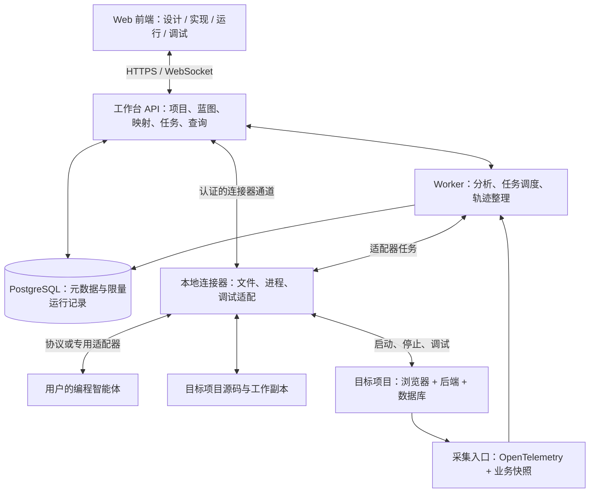

# 技术架构

版本：0.1 / 2026-10-12。以下为拟议架构和内部接口，不表示已经实现或完成兼容性验证。

## 1. 系统组成与部署

建议使用 TypeScript 为主的单仓库。后端先采用模块化单体，耗时分析、智能体任务和采集处理放到独立 worker 进程。根据实际负载再拆服务。



远程智能体适配器可由 worker 直接连接；本地 CLI/ACP 适配器由连接器托管。任务执行位置必须明确，不能假设远程服务可以直接读取用户本机目录。

第一版推荐本机部署 Web 前端、API、worker、连接器和数据库。逻辑上保留连接器边界，后续将 API/数据库迁移到团队服务器时，无需重新设计文件与调试访问。

浏览器文件选择只能提供选中的文件；持续监听、启动进程和接入本机调试器由连接器完成。纯远程使用可后续提供隔离开发容器作为另一种连接器实现。

## 2. 技术选择

| 部分 | 建议 | 选择理由及需要实现的部分 |
| --- | --- | --- |
| 前端 | React + TypeScript + Vite | 三种视图共用项目状态和模块目录 |
| 模块画布 | React Flow | 负责节点、端口、连线与分组交互；业务语义、保存和验证由产品实现 |
| 模块内部积木 | Blockly | 负责积木编辑；产品另行实现模块类型、受限逻辑表示及代码生成 |
| 源码与差异 | Monaco Editor | 展示代码、诊断、差异；模块映射与调试面板由产品实现 |
| 后端 | Node.js + TypeScript + Fastify | 项目、蓝图、权限、任务与查询 API |
| 任务与存储 | PostgreSQL + worker | 用任务表、租约和幂等键实现初期调度；元数据与限量轨迹统一存储 |
| 静态分析 | TypeScript Compiler API + 框架插件 | 解析符号与类型，按已支持模式识别路由、请求与数据库访问 |
| 运行采集 | OpenTelemetry JS + 自有业务快照 SDK | 标准追踪处理调用关系；快照 SDK 补充明确选择的业务数据 |
| 实时调试 | DAP 网关 + JavaScript 调试适配器 | 复用调试器，工作台实现会话与图上定位 |
| 智能体 | 内部 AgentAdapter + ACP / 厂商适配器 | 隔离协议差异、能力差异、认证与生命周期 |

React Flow 提供节点连线界面的基础组件；Blockly 的自定义积木仍需相应生成器。这支持“两层编辑”的选择，但完整产品语义需要自行实现。[React Flow 文档](https://reactflow.dev/learn)、[Blockly 自定义积木](https://docs.blockly.com/guides/create-custom-blocks/overview/)。

TypeScript Compiler API 可提供语法、符号和类型信息。由此推导业务模块是本产品的分析规则，不是编译器自动具备的产品理解能力。[TypeScript Compiler API](https://github.com/microsoft/TypeScript/wiki/Using-the-Compiler-API)。

依赖版本在开工时锁定。JavaScript 调试适配器的独立分发方式、许可证、Windows 路径和 source map 行为要在首个技术验证中检查。

## 3. 前端模块

| 模块 | 责任 |
| --- | --- |
| ProjectShell | 当前项目、工作区、环境、源码版本、权限和连接状态 |
| BlueprintEditor | 画布、模块库、端口验证、撤销重做、积木编辑、验收条件 |
| ImplementationExplorer | 源码结构、搜索、未知调用、证据与人工映射 |
| RunExplorer | 执行列表、环境过滤、轨迹图、时间线、输入输出、日志 |
| DebugWorkbench | 调试会话、断点状态、栈帧、作用域、变量、单步控制 |
| AgentPanel | 任务范围、能力说明、进度、变更、测试结果、接受/退回 |
| SharedInspector | 模块契约、实现绑定和相应版本的运行记录 |

画布数据是领域模型的投影。坐标、缩放、选择态与蓝图语义分离保存。执行记录不可因用户移动画布节点而改变。

大图采用按服务/模块聚合、可见区域渲染和按需展开；运行时间线分页加载。首版不引入多人同时编辑，保存使用版本检查避免静默覆盖。

## 4. 后端模块与职责

| 模块 | 输入与输出 |
| --- | --- |
| Projects | 工作区注册、项目清单、环境、源码快照 |
| Blueprints | 蓝图版本、验证诊断、模块目录、接口契约 |
| Analysis | 源码快照 → 符号/调用/路由图、证据、未知项 |
| Bindings | 蓝图模块 ↔ 源码符号 ↔ 构建制品位置 |
| Agents | 任务上下文、适配器、任务状态、变更集和验证结果 |
| Runs | 启动配置、进程状态、运行会话和日志 |
| Telemetry | 轨迹与业务快照接收、校验、关联、检索和保留策略 |
| Debug | 调试会话授权、消息路由、断点绑定和事件推送 |
| ConnectorRegistry | 连接器身份、心跳、工作区能力和断线状态 |

长任务返回 jobId，前端按事件订阅。worker 为任务获取租约，过期后允许恢复；有副作用的步骤先核对执行状态再重试，不能把“至少一次调度”当成“只执行一次”。

## 5. 核心数据模型

### 5.1 三种图与关联表

| 对象 | 建议关键字段 | 不变量 |
| --- | --- | --- |
| Project | id、name、workspaceId、supportedTargets | 工作区范围由连接器注册 |
| BlueprintRevision | id、projectId、revision、schemaVersion、nodes、edges | 已发布的版本不可原地修改 |
| BlueprintNode | id、type、contract、logic、acceptance、executionTarget | nodeId 在移动和重命名时保持稳定 |
| BlueprintEdge | id、kind、sourcePort、targetPort、fieldMapping | 数据、控制、事件、依赖边语义不同 |
| SourceSnapshot | id、commitSha?、manifestHash、dirtyFiles | 包括未提交修改，不能只靠 Git commit |
| ImplementationGraph | id、snapshotId、nodes、edges、unresolved | 每条分析关系保留证据和规则版本 |
| SourceBinding | nodeId、snapshotId、symbolId、path、range、mappingVersion | 支持多对多绑定及失效状态 |
| Environment | id、name、stage、connectorId、capturePolicyId | stage 为 development/test/production 等标签 |
| Run | id、environmentId、snapshotId、buildId、status | 一次启动可包含多次请求和多个 Trace |
| Trace/Span | traceId、spanId、parentSpanId、links、runId、service、timestamps、status | 以 Trace/Span 标识关联，不依赖到达顺序 |
| DataSnapshot | id、traceId、spanId、nodeId?、captureState、input、output、policyId | 原始数据经采集策略处理后才可上送 |
| DebugSession | id、runId、target、adapter、capabilities、state | 变量引用仅在所属暂停状态有效 |
| AgentTask | id、baseSnapshotId、blueprintRevisionId、scope、provider、status | 上下文和基线可追溯 |
| ChangeSet | id、taskId、baseSnapshotId、patches、tests、resultSnapshotId? | 先比对基线，再应用变更 |

“节点是否实现”和“某次执行是否成功”是不同字段。Trace 成功也不能证明业务断言成立，例如未抛异常的错误金额仍需验收测试识别。

### 5.2 受限逻辑表示

蓝图使用版本化 JSON 表示；积木转换成产品自己的受限逻辑 AST，例如 sequence、validate、calculate、branch、call。Blockly 序列化信息可作为编辑元数据保留，但不作为跨版本业务契约。

首版类型检查覆盖基础类型、记录结构、必填字段和明确声明的转换；不承诺完整实现所有 JSON Schema 的可赋值关系。遇到无法确认的连接，返回“需要适配/人工确认”，而非静默接线。

常见页面和接口由确定性模板生成；智能体实现自定义模块并遵循输入输出与测试契约。目标软件在自己的前后端进程中运行，工作台不解释执行所有应用业务。

### 5.3 蓝图与代码的同步规则

- 新生成项目：蓝图管理结构、契约和受控逻辑，源码映射文件记录具体实现；自定义代码块单独维护。
- 已导入项目：代码快照是实现事实，自动生成的图是分析结果；先建立映射，再决定哪些部分纳入蓝图管理。
- 手工改代码：重新计算文件与符号标识，更新可确认的映射；受控区域被修改时标记漂移并呈现差异。
- 智能体改代码：在工作副本中进行，应用前做基线检查和测试；不能直接用旧蓝图覆盖用户新代码。
- 旧运行记录：始终引用当时的快照和构建版本。源码位置依赖版本化绑定及 source map，不能长期只存行号。

首版不承诺任意源码与积木之间无损双向转换。无法归约的代码展示为自定义模块，并保留源码编辑入口。

## 6. 智能体接入

### 6.1 协议分工

ACP（此处指 Agent Client Protocol）用于编辑器/工作台与编程智能体的交互，适合作为一种会话适配入口。[ACP 官方仓库](https://github.com/agentclientprotocol/agent-client-protocol)。

MCP 用于向智能体提供工具和上下文。工作台可以提供读取蓝图、获取选中模块源码、读取脱敏轨迹、提交变更建议等工具；MCP 本身不定义本产品的完整开发任务执行循环。[MCP 架构文档](https://modelcontextprotocol.io/docs/learn/architecture)。

### 6.2 内部适配器契约

下列为产品内部接口草案，不是 ACP 或任一供应商的原生方法名。

```ts
interface AgentAdapter {
  describeCapabilities(): Promise<AgentCapabilities>;
  createSession(context: TaskContext): Promise<SessionRef>;
  submitTask(session: SessionRef, task: TaskSpec): AsyncIterable<AgentEvent>;
  cancelTask(session: SessionRef, taskId: string): Promise<CancelResult>;
  closeSession(session: SessionRef): Promise<void>;
}
```

能力字段分别描述读取文件、编辑文件、执行命令、返回结构化变更、取消、恢复与远程运行。对不支持的能力显示缺失状态。协议版本协商和厂商认证放在适配器内部；任务层不依赖厂商消息结构。

标准事件包括 progress、message、tool-request、change-proposed、test-result、completed、failed。权限不足以产品事件返回；不能把普通文本消息中的“完成”解析为可信成功信号。

任务状态为 queued → running → waiting-user / succeeded / failed；取消经过 cancel-requested → cancelled。取消回执需确认实际任务状态；断线时保持 unknown/reconnecting，避免显示已经停止。

### 6.3 任务执行与变更

TaskContext 包含项目 ID、蓝图版本、基线快照、相关模块、依赖契约、选定源码、验收条件和允许操作范围。加入运行数据时使用已筛选快照。

首版对 Git 项目使用独立工作副本；非 Git 项目可用受控临时副本和文件哈希。工作副本保留用户未提交内容，并在任务结束时生成变更集。Git worktree 只提供改动隔离，不是执行安全沙箱。

对可信本地项目，可由用户配置运行权限和工作目录；多租户或不可信任务需要容器/虚拟机级执行隔离、资源配额和网络策略后才能开放。导入时不能自动安装依赖或执行仓库脚本。

首版交付前选择一个具备公开接入方式、可获得测试凭据的智能体做端到端验收。适配层与模拟器只能用于开发测试，不能作为真实接入完成的证据。

## 7. 项目导入与分析流水线

1. 连接器读取用户选定工作区，记录文件清单与快照。遵循忽略规则，排除构建产物、大型二进制和密钥文件。
2. 检测 package.json、tsconfig、目录结构和框架特征，报告支持级别；解析项目配置不等于执行配置代码。
3. 用语法与类型分析提取组件、函数、类型、导入与可解析调用；框架插件识别受支持的路由声明与客户端请求模式。
4. 对静态可解析请求地址匹配路由，并保留方法、基础地址和路径规则。动态 URL 标记待确认。
5. 生成按服务/模块聚合的实现图。保存定位证据、推断规则和未知调用列表。
6. 用户确认分组及绑定；后续采集用明确模块标识或版本化符号映射关联运行数据。

外部数据库或 HTTP 服务内部没有接入权限时，仅显示边界、请求摘要和可见响应。函数依赖和数据关系分开存储，不能把全部依赖边动画化为“真实数据流”。

## 8. 运行采集与数据展示

### 8.1 两种互补数据

OpenTelemetry Trace/Span 记录工作单元及其关系；业务快照 SDK 记录选中模块的输入、输出或重要中间值。OpenTelemetry 的上下文传播与 Span Links 可支持跨服务及异步因果关联。[OpenTelemetry Traces](https://opentelemetry.io/docs/concepts/signals/traces/)。

SDK 建议提供以下产品级接口，具体实现待开发：

```ts
observeModule({ nodeId, input, capturePolicy }, async () => {
  return runBusinessLogic();
});
```

SDK 需要正确处理异步上下文、异常、嵌套调用、递归对象及截断。业务函数失败时记录异常并原样向上传播；采集失败默认不能改变业务返回结果。

自动埋点优先覆盖支持的 HTTP 和数据库驱动；业务输入/输出只在受控积木生成代码或显式包装的模块中提供。不能把自动埋点描述为自动获取全部局部变量。

### 8.2 关联链路

浏览器事件创建上下文 → 受支持请求携带 trace context → 后端接续上下文 → 业务 Span → 数据库客户端 Span → 响应与前端结果展示。

浏览器跨域传播需要配置允许的目标域及服务端 CORS，防止上下文误发到无关第三方。网络失败和缺失传播必须在界面标明；不得仅用相近时间戳拼接不同请求。

运行上下文包含 projectId、environmentId、runId、snapshotId、buildId。nodeId 是受控业务埋点的附加属性。批处理、消息队列、重试用独立 Span、links 和 attempt 标识，不能假定所有执行是单链。

### 8.3 接收、存储和前端更新

标准 Span 使用 OTLP 接收入口，并按官方消息定义解析；业务快照使用产品自己的受版本控制的 JSON 接口。示例文件展示的是内部归一化模型，不是 OTLP 传输格式。

接收端认证 → 大小/结构校验 → 脱敏复核 → 入队 → 幂等存储 → 关联模块与版本 → 推送增量事件。

首版用 PostgreSQL 分表存储 trace 摘要、Span 和有大小限制的 JSON 快照，按项目、环境、时间查询；设置保留周期与记录配额。后续可接 OpenTelemetry Collector，再按规模将轨迹迁移到专用后端，把大快照放对象存储；以存储接口隔离变化。

消息可能延迟、重复、乱序或丢失。Span 的幂等键为项目范围内的 traceId + spanId；快照使用自身事件 ID。前端事件携带游标，重连后补拉，保留 partial 状态。服务端不相信客户端提交的项目/环境身份，须与采集凭据绑定关系核对。

### 8.4 快照与环境策略

采集策略定义允许字段、屏蔽字段、大小上限、对象深度、采样条件与保留时间。在采集端先处理，服务端再复核；Authorization、Cookie、密码、密钥等不进入默认采集内容。

变量值来自当前暂停点的调试器，业务快照来自显式埋点，两者在 UI 上标明来源与时间。调试变量默认不长期保存，也不自动加入智能体任务。

OpenTelemetry 无法自行判断所有业务敏感字段，官方建议应用侧实施最小采集及过滤；本产品需要提供具体采集策略。[敏感数据处理](https://opentelemetry.io/docs/security/handling-sensitive-data/)。

## 9. 实时调试

DAP 在开发工具和调试适配器之间定义调试通信；JavaScript 调试适配器可作为 Node.js 与浏览器调试的候选实现。[DAP 概览](https://microsoft.github.io/debug-adapter-protocol/overview)、[vscode-js-debug](https://github.com/microsoft/vscode-js-debug)。

工作台前端 → Debug 网关 → 连接器 → 调试适配器 → 目标进程。

首版依次验证：初始化及能力协商、launch/attach、源码断点、暂停事件、stackTrace、scopes、variables、continue、next、stepIn、stepOut、disconnect。具体功能按适配器返回能力启用。

源码断点状态至少包括 pending、verified、unbound。图上设置模块断点时，通过 SourceBinding 和 source map 得到真实位置。一个模块多个入口时允许选择，不能假定任意连线都存在可暂停的源码位置。

每次暂停产生 stoppedGeneration；栈帧和变量引用绑定这个代次。继续执行后，旧引用立即过期。复杂变量按需展开并限量读取，避免递归对象和大集合卡死界面。首版不开放任意表达式求值和自动触发 getter。

断线、进程退出或继续失败时，界面显示真实会话状态，并提供明确的继续/停止操作。生产默认不开放暂停式调试。模块与当前 Span 的关联只在 SDK 提供明确上下文时展示；无法确定当前请求时应说明。

## 10. HTTP 与事件接口草案

下列路径均为内部设计，尚未实现。统一前缀 /api/v1，除专用采集协议入口外。

| 方法与路径 | 用途 |
| --- | --- |
| POST /projects | 通过已注册 workspaceId 建立项目 |
| POST /projects/:id/import-jobs | 针对源码快照发起只读分析 |
| GET /projects/:id/implementation-graphs/:graphId | 读取分析图及未知项 |
| POST /projects/:id/blueprint-revisions | 携带 baseRevision 保存新版本 |
| POST /projects/:id/blueprint-validations | 验证端口、必填字段与受限逻辑 |
| POST /projects/:id/agent-tasks | 创建带范围和基线的智能体任务 |
| GET /agent-tasks/:id/changes | 查看变更及验证证据 |
| POST /change-sets/:id/apply | 核对 expectedSnapshotId 后应用选定变更 |
| POST /projects/:id/runs | 在已授权连接器上启动选定运行配置 |
| POST /runs/:id/stop | 停止指定运行会话 |
| GET /projects/:id/traces | 按环境、运行、时间、状态检索 |
| GET /projects/:id/traces/:traceId | 获取 Span、快照状态和源码绑定 |
| POST /capture-events | 接收鉴权后的业务快照批次 |
| POST /debug-sessions | 创建针对某个 run 的调试会话 |
| POST /agent-tasks/:id/cancel | 请求取消并等待确认状态 |
| GET /jobs/:id | 获取长任务进度、结果和错误 |
| WS /events | 订阅带游标的项目/任务/轨迹事件 |
| WS /debug-sessions/:id/channel | 受能力和权限限制的调试消息通道 |
| POST /v1/traces（独立入口） | 接收标准 OTLP/HTTP Trace 数据 |

所有写请求携带幂等键或修订条件。冲突返回当前版本和可用差异。路径、工作区与连接器关联由服务端校验；外部请求不能直接传任意本机绝对路径作为执行目标。

## 11. 工程目录建议

```text
apps/
  web/                     工作台前端
  api/                     HTTP、WebSocket、采集接收入口
  worker/                  分析、任务、轨迹处理
  connector/               本地文件、执行与调试代理
packages/
  domain/                  蓝图、契约、版本与事件类型
  blueprint-compiler/      模板生成、受限逻辑转换、绑定清单
  analyzer-typescript/     符号、调用和框架分析
  analyzer-fastify/         Fastify 支持规则
  agent-adapters/          内部接口和首个真实适配器
  telemetry-sdk/           业务节点采集与环境标识
  debug-gateway/           DAP 会话和源码映射
  persistence/             数据库迁移与存储接口
examples/
  order-app/               未来的受控前后端验收项目
```

## 12. 第一阶段必须验证的风险

| 风险 | 验证方式 | 未通过时的降级 |
| --- | --- | --- |
| 模块无法稳定对应代码 | 修改文件、改名、重构后检查绑定 | 标记失效，要求重新映射 |
| 框架分析误判为数据流 | 用已知项目比对解析图与真实轨迹 | 保留结构图，未知调用不连成确定路径 |
| 前后端 Trace 断开 | 真实浏览器请求检查 trace context | 显示断点，提示采集/CORS 配置缺口 |
| 调试器不能稳定独立接入 | 在 Windows 上验证 TS source map 与断点 | 保留源码/轨迹检查，实时调试不能标为已交付 |
| 智能体接口能力不一致 | 真适配器端到端任务、取消与冲突测试 | 明示能力限制或提供手动任务包 |
| 采集拖慢应用或泄露字段 | 用相同负载对比延迟/内存并检查快照 | 降低采样、缩小字段与对象上限 |

性能目标先在固定参考机与示例项目上测量基线，再制定指标。设计阶段不承诺“任意项目全部可视化”或未实测的性能数字。
